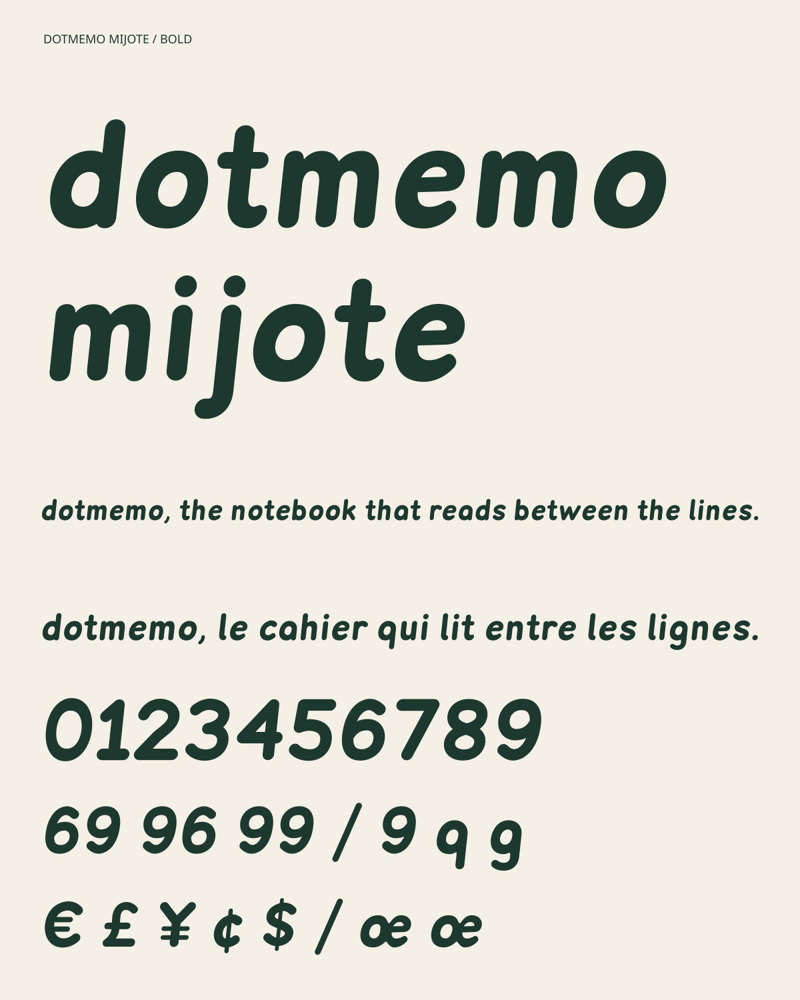

# dotmemo mijote

A rounded, proportional typeface.



## Build

Requires Python 3.11–3.13 and [uv](https://docs.astral.sh/uv/).
Run from the repository root:

```sh
uv sync --locked
make build
make check
make test
make lint
```

Outputs are written to `build/`: TTF, WOFF2, UFO 3, OpenType features,
individual SVG glyphs, a codepoint inventory, a specimen and a SHA-256 manifest.
Run `make preview` and open `http://127.0.0.1:8000` for the interactive specimen.

## Font

The current face is Bold, weight 800, with 225 mapped Unicode codepoints,
proportional spacing and a forward slant of approximately 6°.
OpenType features include `ccmp`, `kern` and `mark`. Mark-to-mark stacking is
not implemented. See the generated `build/coverage.csv` for exact coverage.

## Development

- [Source format and build architecture](docs/architecture.md)
- [Contributing](CONTRIBUTING.md)
- [Integration](docs/integration.md)
- [Release checks](docs/releasing.md)

Sources live in `sources/`, tooling in `src/dotmemo_mijote/`, and tests in `tests/`.
Generated files and local working material are excluded from Git.

## Licensing

Fonts and their drawing sources are licensed under OFL 1.1, with no Reserved
Font Names. Independent tools are licensed under MIT. See
[licence scope](docs/licensing.md), [LICENSE](LICENSE) (OFL) and [LICENSE-MIT](LICENSE-MIT).
